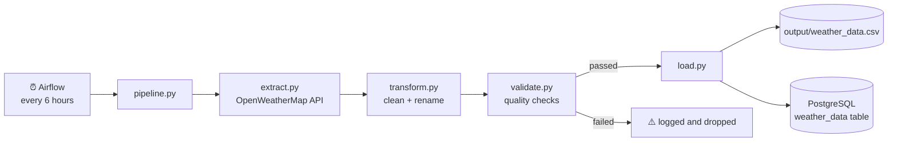

# 🌦️ SA Weather ETL Pipeline

<p align="center">


</p>

<p align="center">
A Python ETL pipeline that collects <strong>live weather data</strong> for one city in each of South Africa's nine provinces, checks its quality, and stores it in both a <strong>CSV file</strong> and a <strong>PostgreSQL</strong> database. <strong>Apache Airflow</strong> runs it automatically every 6 hours, and <strong>Docker Compose</strong> packages the whole thing so it runs the same on any machine.
</p>

---

## 📖 Table of Contents

1. [What this project does](#-what-this-project-does)
2. [How it works, stage by stage](#-how-it-works-stage-by-stage)
3. [Project structure](#-project-structure)
4. [Tech stack and why each piece is here](#️-tech-stack-and-why-each-piece-is-here)
5. [Before you start (prerequisites)](#-before-you-start-prerequisites)
6. [Configuration: the `.env` file](#️-configuration-the-env-file)
7. [Run it with Docker (recommended)](#-run-it-with-docker-recommended)
8. [Run it locally without Docker](#-run-it-locally-without-docker)
9. [Run the tests](#-run-the-tests)
10. [Where your output ends up](#-where-your-output-ends-up)
11. [Command cheat sheet](#-command-cheat-sheet)
12. [Data and database reference](#-data-and-database-reference)
13. [Dashboards (HTML and Power BI)](#-dashboards-html-and-power-bi)
14. [Design notes and known limitations](#-design-notes-and-known-limitations)
15. [Troubleshooting](#-troubleshooting)
16. [Roadmap](#-roadmap)
17. [Contributing, author, license](#-contributing-author-license)

---

## 🚀 What this project does

Weather data is a good way to practise real data engineering, because it changes constantly and the source (an API) can fail or return odd values. This pipeline does the same job a production data team would automate:

1. **Extract**: calls the [OpenWeatherMap](https://openweathermap.org/api) API for nine cities.
2. **Transform**: throws away everything it does not need and renames the rest into a clean, flat record.
3. **Validate**: rejects any record with missing fields or physically impossible values (humidity of 150%, for example) so bad data never reaches storage.
4. **Load**: appends the good records to a CSV file **and** inserts them into a PostgreSQL table.
5. **Schedule**: Airflow repeats all of this every 6 hours, so over time you build up a history of weather readings you can chart.

**Cities covered (one per province):**

| Province | City queried |
|---|---|
| Gauteng | Johannesburg |
| Western Cape | Cape Town |
| KwaZulu-Natal | Durban |
| Eastern Cape | Port Elizabeth (now Gqeberha) |
| Free State | Bloemfontein |
| Limpopo | Polokwane |
| Mpumalanga | Nelspruit (now Mbombela) |
| North West | Mahikeng |
| Northern Cape | Kimberley |

> Port Elizabeth and Nelspruit use their older names on purpose: the OpenWeatherMap API recognises those names more reliably than the new official ones.

---

## 🔄 How it works, stage by stage



`pipeline.py` is the conductor: it calls each stage in order, and stops early (with an error in the log) if nothing was extracted or nothing passed validation.

### 1. Extract (`extract.py`)
- Loops over the nine cities and makes one API request each: `GET /data/2.5/weather?q=<city>,ZA&units=metric`.
- `units=metric` is why the data comes back in **°C** and **metres per second**, and why the column names end in `_c` and `_mps`.
- Each request has a 10-second timeout. If one city fails (timeout, no internet, non-200 response) it is logged and skipped, and the other cities carry on. A run with 8 of 9 cities is still useful.
- The province is attached to each response here, because the API does not know which province a city is in.

### 2. Transform (`transform.py`)
The API returns a large nested JSON document per city. This stage turns it into one flat record:

| Output field | Where it comes from in the API response |
|---|---|
| `city`, `country` | `name`, `sys.country` |
| `province` | added in the extract step |
| `temperature_c`, `feels_like_c`, `temp_min_c`, `temp_max_c` | `main.temp`, `main.feels_like`, `main.temp_min`, `main.temp_max` |
| `humidity_percent` | `main.humidity` |
| `wind_speed_mps` | `wind.speed` |
| `condition` | `weather[0].description` |
| `extracted_at` | the time the pipeline ran (not the time the weather was observed) |

### 3. Validate (`validate.py`)
Every record must pass all of these checks or it is dropped (and a warning explaining why is written to the log):

| Check | Rule |
|---|---|
| Required fields | all 11 fields present and non-empty |
| Temperatures (current, feels-like, min, max) | between -20 °C and 60 °C |
| Humidity | between 0 and 100 % |
| Wind speed | between 0 and 113 m/s |
| Consistency | `temp_min_c` must not be greater than `temp_max_c` |

### 4. Load (`load.py`, `db.py`)
- `create_table()` makes sure the `weather_data` table exists. It is safe to run on every run, because it uses `CREATE TABLE IF NOT EXISTS`.
- **CSV:** rows are appended to `weather_data.csv`; the header is written only when the file is first created.
- **PostgreSQL:** all rows of a run are inserted in a single transaction, so either the whole batch is saved or none of it is.
- Finally, `preview_postgres()` prints the five most recent rows and the total row count so you can see it worked.

### 5. Orchestrate (`dags/weather_pipeline_dag.py`)
- DAG id: `sa_weather_etl_pipeline`. Schedule: `0 */6 * * *` (00:00, 06:00, 12:00, 18:00 in the Airflow server's timezone, which is UTC by default).
- One task runs `cd /opt/airflow/weather_etl && python pipeline.py`, which is exactly the same code the standalone `app` container runs. The DAG has no pipeline logic of its own.
- If a run fails, Airflow retries once after 5 minutes. `catchup=False` means that if Airflow was switched off for a day, it will not try to run all the missed runs when it comes back.

### 6. Log (`logger.py`)
Every stage writes to the terminal **and** to a daily file, `logs/pipeline_YYYY-MM-DD.log`, in the format `time | level | module | message`. When something goes wrong, this file is the first place to look.

---

## 📁 Project structure

```text
sa-weather-etl-pipeline/
│
├── weather_etl/                  # The pipeline itself
│   ├── pipeline.py               # Entry point: runs extract → transform → validate → load
│   ├── extract.py                # API calls + the list of cities/provinces
│   ├── transform.py              # Raw JSON → flat clean records
│   ├── validate.py               # Data-quality rules
│   ├── load.py                   # Writes to CSV and PostgreSQL
│   ├── db.py                     # Database connection + table creation
│   └── logger.py                 # Console + daily log file
│
├── dags/
│   └── weather_pipeline_dag.py   # Airflow DAG (the 6-hour schedule)
│
├── docker/airflow/Dockerfile     # Airflow image + this project's Python packages
├── Dockerfile                    # Image for the standalone pipeline ("app")
├── docker-compose.yml            # Defines all 6 services and how they connect
│
├── tests/test_pipeline.py        # 14 unit tests (transform + validate)
├── conftest.py                   # Lets pytest find the modules in weather_etl/
│
├── dashboard.html                # Standalone visual dashboard (static snapshot)
├── PowerBI.md                    # Step-by-step Power BI setup guide
│
├── requirements.txt              # Python dependencies for the pipeline
├── .env                          # Your private settings (never commit this)
├── output/                       # CSV written by the Docker "app" container
└── logs/                         # Log files written by the Docker "app" container
```

---

## 🛠️ Tech stack and why each piece is here

| Technology | Role in this project |
|---|---|
| **Python 3.10** | Language for all pipeline code |
| **Requests** | Makes the HTTP calls to the weather API |
| **psycopg2** | Lets Python talk to PostgreSQL |
| **python-dotenv** | Reads `API_KEY` and database settings from `.env` so no secrets are hard-coded |
| **PostgreSQL 15** | Permanent, queryable storage: this is what Power BI or SQL queries read from |
| **CSV** | Simple flat-file copy of the same data, easy to open in Excel |
| **Apache Airflow 2.9** | Runs the pipeline on a schedule, retries failures, and gives you a web UI with run history |
| **Docker + Docker Compose** | Starts the databases, the pipeline and Airflow with one command, with no manual installs |
| **pytest** | Runs the unit tests |
| **OpenWeatherMap API** | The data source |

---

## ✅ Before you start (prerequisites)

| You need | Why | How to check |
|---|---|---|
| **Git** | To download the project | `git --version` |
| **Docker Desktop** (includes Docker Compose v2) | Runs the whole stack in containers. Needed for the Docker route and handy for the local route (to get a database) | `docker --version` and `docker compose version` |
| **Python 3.10** | Only for the local (non-Docker) route and for running tests | `python3 --version` |
| **A free OpenWeatherMap API key** | The API refuses requests without one | Sign up at [openweathermap.org](https://openweathermap.org/api), then copy the key from *My API keys* |

> **Heads-up:** a brand-new API key can take up to a couple of hours to activate. Until then the API answers `401`, which looks like a bug in the pipeline but is not.

---

## ⚙️ Configuration: the `.env` file

Docker Compose and the Python code both read their settings from a file named exactly `.env` in the project root.

**Create it:**

```bash
# macOS / Linux
touch .env
# Windows PowerShell
New-Item .env -ItemType File
```

**Then paste this in and edit the values:**

```env
# --- PostgreSQL (the weather database) ---
DB_HOST=localhost
DB_PORT=5432
DB_NAME=weather_db
DB_USER=weather_user
DB_PASSWORD=choose_a_password

# --- OpenWeatherMap ---
API_KEY=paste_your_openweathermap_key_here

# --- Airflow ---
AIRFLOW_UID=50000        # On Linux use your own user id: run `id -u` and paste the number
```

| Variable | Used by | What it does |
|---|---|---|
| `DB_HOST` | local runs only | Where Postgres lives. Use `localhost` when running outside Docker. **Docker Compose overrides this to `postgres` for the containers**, so you do not need to change it between routes |
| `DB_PORT` | Compose + local runs | The port Postgres is published on on your machine. Change it (e.g. `5433`) if something else already uses 5432 |
| `DB_NAME`, `DB_USER`, `DB_PASSWORD` | Compose + pipeline | Compose creates the database with these on first start; the pipeline logs in with them |
| `API_KEY` | pipeline | Your OpenWeatherMap key |
| `AIRFLOW_UID` | Compose | The user id Airflow runs as inside its container. It should match your own on Linux so Airflow can write files in your project folder |

> 🔒 **Never commit `.env` or share your API key.** `.gitignore` already excludes `.env`. If a key is ever pasted into a chat, screenshot or public repo, regenerate it in your OpenWeatherMap account.

---

## 🐳 Run it with Docker (recommended)

This starts everything: the weather database, the pipeline, and the full Airflow stack.

### Step 1: Download the project
```bash
git clone https://github.com/Bongane0606/sa-weather-etl-pipeline.git
cd sa-weather-etl-pipeline
```
**Why:** `clone` copies the code to your machine; `cd` moves into it, because every later command must be run from the project root (where `docker-compose.yml` and `.env` live).

### Step 2: Create your `.env`
Follow [Configuration](#️-configuration-the-env-file) above.
**Why:** `docker-compose.yml` is full of placeholders like `${DB_USER}` and `${API_KEY}`. Compose fills them in from `.env`. Without it, the containers start with blank passwords and no API key.

### Step 3: Build and start everything
```bash
docker compose up -d --build
```
**Why each part:**
- `docker compose up` creates and starts all six services defined in `docker-compose.yml`.
- `-d` ("detached") runs them in the background so your terminal stays free.
- `--build` rebuilds the images from the Dockerfiles. It is needed the first time, and any time you change `requirements.txt` or the pipeline code that the `app` image copies in.

The first run takes a few minutes while images download. Here is what starts:

| Service | Container name | What it is | Normal state |
|---|---|---|---|
| `postgres` | `weather_postgres` | The database that stores your weather data | Running, `healthy` |
| `app` | `weather_pipeline` | Runs the pipeline **once** straight away, then stops | `Exited (0)` ✅ |
| `airflow-postgres` | `airflow_postgres` | A separate database for Airflow's own bookkeeping | Running, `healthy` |
| `airflow-init` | `airflow_init` | One-off setup: prepares Airflow's database and creates the admin user | `Exited (0)` ✅ |
| `airflow-webserver` | `airflow_webserver` | The Airflow web UI | Running |
| `airflow-scheduler` | `airflow_scheduler` | Triggers the DAG on schedule | Running |

> The weather data and Airflow's metadata live in **two separate databases on purpose**, so Airflow's housekeeping never mixes with your data.

### Step 4: Check that everything is healthy
```bash
docker compose ps -a
```
**Why:** shows every service and its state. `-a` includes containers that have finished, such as `app` and `airflow-init`, which is what you expect. `Exited (0)` means "finished with no crash", **not** necessarily "loaded data", so do Step 5 as well.

### Step 5: Confirm the pipeline actually loaded data
```bash
docker compose logs app
```
**Why:** `app` ran the pipeline once at start-up and exited, so its log is the record of that run. Look for `Extraction complete — 9/9 cities successful`, `Validation complete — 9 passed, 0 failed` and `Successfully inserted 9 records into PostgreSQL`. If you see errors instead, go to [Troubleshooting](#-troubleshooting).

Then check the database directly:
```bash
docker compose exec postgres sh -c 'psql -U "$POSTGRES_USER" -d "$POSTGRES_DB" -c "SELECT city, province, temperature_c, extracted_at FROM weather_data ORDER BY extracted_at DESC LIMIT 9;"'
```
**Why:** `exec` runs a command inside the running Postgres container. `psql` is Postgres's command-line client, and the `$POSTGRES_...` variables are already set inside that container, so you do not have to retype your credentials. Seeing nine fresh rows proves the whole chain works.

### Step 6: Open Airflow and turn the schedule on
Open **http://localhost:8080** and log in with username `admin`, password `admin`.

1. Find the DAG **`sa_weather_etl_pipeline`**.
2. Flip its toggle to **on** (Airflow creates new DAGs paused, so nothing runs until you do this).
3. To test it immediately without waiting for the next 6-hour slot, click the ▶ **Trigger DAG** button.

Prefer the terminal? These do the same thing:
```bash
docker compose exec airflow-scheduler airflow dags unpause sa_weather_etl_pipeline
docker compose exec airflow-scheduler airflow dags trigger sa_weather_etl_pipeline
```
**Why:** the Airflow command-line tool lives inside the Airflow containers, so you reach it through `docker compose exec`.

> `admin` / `admin` is fine on your own laptop. Change it before exposing Airflow to a network.

### Run the pipeline again whenever you want
```bash
docker compose run --rm app
```
**Why:** the `app` container is a "run once and exit" job. `run` starts a fresh copy, and `--rm` deletes that copy afterwards so stopped containers do not pile up. It also starts the database first if it is not already running.

### Watch what Airflow is doing
```bash
docker compose logs -f airflow-scheduler
```
**Why:** the scheduler is the part that decides when to run the DAG. `-f` ("follow") streams new log lines live; press `Ctrl+C` to stop watching (this does not stop the container).

### Stop everything
```bash
docker compose stop      # pause the containers; keep everything
docker compose down      # remove the containers; KEEP your database data
docker compose down -v   # remove the containers AND delete all stored data
```
**Why:** `stop` is a pause button. `down` tears the containers down, but your data survives because it lives in Docker *volumes*. `down -v` also deletes those volumes, which is useful for a completely fresh start and destructive otherwise. You will lose all stored weather history.

### After you change code
| What you changed | What to run | Why |
|---|---|---|
| Files in `weather_etl/` or `dags/` and you use **Airflow** | nothing | Both folders are mounted into the Airflow containers, so edits apply immediately |
| Files in `weather_etl/` and you use the **`app`** container | `docker compose build app` | The `app` image has its own copy of the code baked in |
| `requirements.txt` | `docker compose up -d --build` | New packages must be installed into both images |

---

## 🐍 Run it locally without Docker

Good for development and debugging, because you can edit code and re-run instantly.

### Step 1: Create and activate a virtual environment
```bash
python3 -m venv venv
source venv/bin/activate        # Windows: venv\Scripts\activate
```
**Why:** a virtual environment is a private folder of Python packages for this project only, so its dependencies cannot clash with other projects on your computer. You will see `(venv)` at the start of your prompt when it is active.

### Step 2: Install the dependencies
```bash
pip install -r requirements.txt
```
**Why:** installs the three packages the pipeline needs (`requests`, `python-dotenv`, `psycopg2-binary`) at the versions the project was built with.

### Step 3: Get a PostgreSQL database
The easiest way is to let Docker run just the database:
```bash
docker compose up -d postgres
```
**Why:** starts only the `postgres` service, using the `DB_*` values from your `.env`, and publishes it on `localhost:DB_PORT`, which is where your local Python script will look. (If you would rather use a Postgres you installed yourself, create a database and user that match your `.env` instead.)

Make sure `.env` has `DB_HOST=localhost`.

### Step 4: Run the pipeline
```bash
cd weather_etl
python pipeline.py
```
**Why `cd weather_etl` first:** the logger writes to a `logs/` folder relative to where you run the command, and the modules import each other by plain name (`from db import ...`). Running from inside `weather_etl/` keeps all of that consistent. (On older Windows PowerShell, run the two lines separately.)

**You should see** the stage-by-stage log, ending in `PIPELINE COMPLETED SUCCESSFULLY` and a preview of the last five database rows:

```text
2026-09-09 08:31:05 | INFO     | pipeline     | STEP 1: EXTRACTING data from API...
2026-09-09 08:31:11 | INFO     | extract      | Extraction complete — 9/9 cities successful
2026-09-09 08:31:11 | INFO     | pipeline     | STEP 2: TRANSFORMING raw data...
2026-09-09 08:31:11 | INFO     | pipeline     | STEP 3: VALIDATING data quality...
2026-09-09 08:31:11 | INFO     | validate     | Validation complete — 9 passed, 0 failed
2026-09-09 08:31:11 | INFO     | pipeline     | STEP 4: LOADING data...
2026-09-09 08:31:12 | INFO     | load         | Successfully inserted 9 records into PostgreSQL
2026-09-09 08:31:12 | INFO     | pipeline     | PIPELINE COMPLETED SUCCESSFULLY
```
*(abridged; the line format is exactly what the logger produces)*

### Debug one stage at a time
From inside `weather_etl/` with the virtual environment active:

| Command | What it does | Why you would use it |
|---|---|---|
| `python extract.py` | Calls the API for all nine cities and logs the result | Quickest way to test that your API key works |
| `python transform.py` | Transforms two built-in fake records and prints them | See the transform output with no internet, API key or database |
| `python db.py` | Tests the database connection and creates the table | Check your `DB_*` settings before running the full pipeline |

> **No database? The pipeline still runs.** If Postgres is unreachable, the database steps log an error and are skipped, and the CSV is still written. See [Design notes](#-design-notes-and-known-limitations).

### When you are done
```bash
deactivate                       # leave the virtual environment
docker compose stop postgres     # if you started Postgres via Docker
```

---

## 🧪 Run the tests

```bash
pip install pytest
pytest tests/ -v
```
**Why:**
- `pytest` is not in `requirements.txt` (it is a developer tool, not something the pipeline needs at run time), so install it once.
- Run the command **from the project root**. `conftest.py` sits there and tells pytest where to find the modules inside `weather_etl/`; run from elsewhere and the imports fail.
- `-v` prints each test by name, so you can see what passed.

**Expected:** `14 passed`. The tests need no API key, no internet and no database. They cover:

| Area | What is checked |
|---|---|
| `transform.py` (5 tests) | correct city name and temperature, all 11 fields present, one output per input, timestamp never empty |
| `validate.py` (9 tests) | a good record passes; empty city name, temperature too high or too low, humidity below 0 or above 100, and min-greater-than-max all fail; `validate_all` keeps good records and drops bad ones; empty input is handled |

> Plain `python -m unittest` will **not** work on its own, because it does not read `conftest.py`. Use pytest, or point Python at the code explicitly: `PYTHONPATH=weather_etl python -m unittest tests.test_pipeline -v` (PowerShell: set `$env:PYTHONPATH="weather_etl"` first).

---

## 📂 Where your output ends up

Different ways of running the pipeline write to different places. This is the most common source of "where did my CSV go?"

| How you ran it | CSV file | Log file | Database |
|---|---|---|---|
| Docker `app` container (`docker compose up` / `docker compose run --rm app`) | `./output/weather_data.csv` | `./logs/` | `weather_data` table |
| Airflow DAG | `./weather_etl/output/weather_data.csv` | `./weather_etl/logs/` | same `weather_data` table |
| Local (`cd weather_etl && python pipeline.py`) | `./weather_etl/output/weather_data.csv` | `./weather_etl/logs/` | same `weather_data` table |

All three write to the **same PostgreSQL table**, which is the reliable single source of truth. The CSV copies are separate files per route.

---

## 📋 Command cheat sheet

| Goal | Command |
|---|---|
| Start everything (first time or after dependency changes) | `docker compose up -d --build` |
| Start everything (already built) | `docker compose up -d` |
| See service status | `docker compose ps -a` |
| Run the pipeline once, now | `docker compose run --rm app` |
| Read the last pipeline run's log | `docker compose logs app` |
| Follow Airflow live | `docker compose logs -f airflow-scheduler` |
| Turn the schedule on | `docker compose exec airflow-scheduler airflow dags unpause sa_weather_etl_pipeline` |
| Trigger an Airflow run now | `docker compose exec airflow-scheduler airflow dags trigger sa_weather_etl_pipeline` |
| Count rows in the database | `docker compose exec postgres sh -c 'psql -U "$POSTGRES_USER" -d "$POSTGRES_DB" -c "SELECT COUNT(*) FROM weather_data;"'` |
| Run only the database (for local runs) | `docker compose up -d postgres` |
| Run tests | `pytest tests/ -v` |
| Pause everything | `docker compose stop` |
| Remove containers, keep data | `docker compose down` |
| Remove containers **and all data** | `docker compose down -v` |

---

## 📊 Data and database reference

### Fields

| Field | Type in PostgreSQL | Description |
|---|---|---|
| `id` | `SERIAL PRIMARY KEY` | Auto-incrementing row id (database only; not in the CSV) |
| `city` | `VARCHAR(100)`, required | City name as returned by the API |
| `province` | `VARCHAR(100)` | South African province |
| `country` | `VARCHAR(10)`, required | Country code (`ZA`) |
| `temperature_c` | `NUMERIC(5,2)` | Current temperature, °C |
| `feels_like_c` | `NUMERIC(5,2)` | "Feels like" temperature, °C |
| `temp_min_c` | `NUMERIC(5,2)` | Minimum temperature reported, °C |
| `temp_max_c` | `NUMERIC(5,2)` | Maximum temperature reported, °C |
| `humidity_percent` | `INTEGER` | Relative humidity, % |
| `wind_speed_mps` | `NUMERIC(5,2)` | Wind speed, metres per second |
| `condition` | `VARCHAR(200)` | Text description, e.g. `clear sky` |
| `extracted_at` | `TIMESTAMP` | When the pipeline ran |

### Sample rows (from a real run)

| city | province | country | temperature_c | feels_like_c | temp_min_c | temp_max_c | humidity_percent | wind_speed_mps | condition | extracted_at |
|---|---|---|---:|---:|---:|---:|---:|---:|---|---|
| Johannesburg | Gauteng | ZA | 15.3 | 14.9 | 14.3 | 16.1 | 77 | 0.9 | clear sky | 2026-09-09 08:31:05 |
| Cape Town | Western Cape | ZA | 15.9 | 16.0 | 15.2 | 15.9 | 96 | 5.1 | clear sky | 2026-09-09 08:31:05 |
| Durban | KwaZulu-Natal | ZA | 24.2 | 24.4 | 23.5 | 24.2 | 66 | 0.5 | clear sky | 2026-09-09 08:31:05 |

### Connect your own tools to the database
While the `postgres` container is running, any SQL client (DBeaver, pgAdmin, Power BI, `psql`) can connect with:
**host** `localhost` · **port** your `DB_PORT` · **database** your `DB_NAME` · **user/password** your `DB_USER` / `DB_PASSWORD`.

---

## 📈 Dashboards (HTML and Power BI)

**`dashboard.html`**: a self-contained visual dashboard (charts, run history, a searchable data table). Open it by double-clicking the file or dragging it into a browser; no server is needed, but you do need internet access, because it loads Chart.js and fonts from a CDN.

> It is a **static snapshot**: the pipeline output was embedded into the file when it was generated (readings up to 2026-09-09). It does not read `output/weather_data.csv` live, so it will not show new runs until the embedded data is regenerated.

**Power BI**: [`PowerBI.md`](PowerBI.md) is a copy-and-paste guide covering connecting to PostgreSQL or the CSV, the Power Query steps, DAX measures and a suggested report layout. Use your own `DB_NAME` where the guide shows a database name. Power BI connects to `localhost` and your `DB_PORT`, so the `postgres` container must be running.

---

## 📝 Design notes and known limitations

Understanding these will save you confusion, and they make good next improvements.

| Behaviour | What it means |
|---|---|
| **History accumulates; no de-duplication** | Every run appends 9 new rows (about 36 a day on the 6-hour schedule). That is intentional for time-series analysis, but running the pipeline several times in a row adds near-identical rows. |
| **`extracted_at` is run time, not observation time** | It is the pipeline's clock when it ran, which is usually UTC inside Docker containers (South Africa is UTC+2), not the moment OpenWeatherMap measured the weather. |
| **A run can "succeed" without saving to the database** | If Postgres is unreachable, the load step logs an error but the pipeline still prints `PIPELINE COMPLETED SUCCESSFULLY`, and Airflow marks the task green. Always check the logs or the row count. |
| **Failed records are dropped, not stored** | Records that fail validation are only recorded as warnings in the log; there is no "rejected records" table. |
| **Partial API failures are tolerated** | If 1 of 9 cities fails, the other 8 are still loaded. If all 9 fail, the pipeline stops early. |
| **Separate CSV per route** | See [Where your output ends up](#-where-your-output-ends-up). |

---

## 🐛 Troubleshooting

| Symptom | Likely cause | What to do |
|---|---|---|
| Log shows `Status: 401` | API key missing, wrong, or not activated yet | Check `API_KEY` in `.env` (no quotes or spaces). New keys can take up to a couple of hours to activate. Test with `cd weather_etl && python extract.py` |
| `API_KEY is not set` in the log | `.env` is missing or not in the project root | The file must be named exactly `.env` and sit next to `docker-compose.yml` |
| Log shows `Failed to connect to database` (local run) | Postgres not running, or wrong `DB_HOST`/`DB_PORT` | Run `docker compose up -d postgres`, set `DB_HOST=localhost`, then test with `python db.py` |
| Connection problems inside Docker | `postgres` is not healthy yet | `docker compose ps -a`; wait for `healthy`, then `docker compose run --rm app` |
| `password authentication failed` after you edited `DB_PASSWORD` | Postgres only applies the password the **first** time its data volume is created | If you do not need the old data: `docker compose down -v`, then `docker compose up -d --build` |
| Port 5432 (or 8080) already in use | Another program is using it | Change `DB_PORT` in `.env` (e.g. `5433`), or stop the other program |
| `docker compose ps` shows `app` as `Exited (0)` | Normal: it is a run-once job | Check `docker compose logs app` to confirm it loaded data |
| Airflow login or "no username" init error | The Airflow entrypoint was overridden | Do not set a custom `entrypoint` on Airflow services; the image's own entrypoint registers `AIRFLOW_UID`. Let `airflow-init` run as defined |
| Airflow cannot write to `weather_etl/output` (Linux) | `AIRFLOW_UID` does not match your user | Set `AIRFLOW_UID` to the output of `id -u` in `.env`, then `docker compose up -d --build` |
| DAG not running on schedule | DAG is still paused | Toggle it on in the UI or run the `dags unpause` command above |
| CSV has no header, or columns look shifted | An old CSV from before the `province` column was added is being appended to | Back up the old file, delete it, and run the pipeline again so a correct one is created |
| `ModuleNotFoundError` | Virtual environment not active, or packages not installed | `source venv/bin/activate` then `pip install -r requirements.txt` |
| Tests fail with `ModuleNotFoundError: transform` | Not run from the project root, or run with plain `unittest` | `cd` to the project root and run `pytest tests/ -v` |

---

## 🗺️ Roadmap

- [x] PostgreSQL integration
- [x] Apache Airflow scheduling
- [x] Docker support
- [x] Data quality validation
- [x] Logging
- [x] Unit tests
- [x] All nine South African provinces
- [x] HTML dashboard (static snapshot)
- [ ] Power BI report (setup guide ready in [`PowerBI.md`](PowerBI.md))
- [ ] Dashboard that refreshes automatically from the database
- [ ] Store the API's observation time and de-duplicate repeated readings
- [ ] Make a failed database load fail the Airflow task

---

## 🤝 Contributing, author, license

**Contributing:** fork the repository, create a feature branch, commit your changes, push, and open a Pull Request. Please run `pytest tests/ -v` first.

**Author: Letsoenyo Clen Bongane**, aspiring Data Engineer passionate about building scalable data pipelines and turning raw data into meaningful insights.

- 💼 LinkedIn: https://linkedin.com/in/Bongane_Clen
- 💻 GitHub: https://github.com/Bongane0606

**Why I built this:** to learn the fundamentals of data engineering beyond the ETL steps themselves: data-quality validation, structured logging, a persistent database sink, scheduled orchestration, and containerisation. It started as a four-city script and grew into a pipeline covering every South African province.

**License:** MIT. Feel free to use, modify and distribute it under the licence terms.

⭐ If you found this useful, consider starring the repo.

WTC-R8WUGX63
