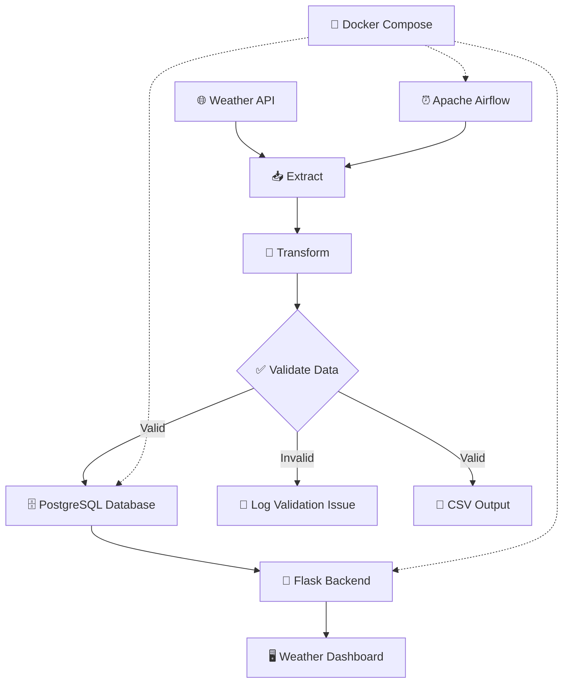

# 🌦️ SA Weather ETL Pipeline
### From Raw Weather Data to an Interactive South African Weather Dashboard


**A complete data engineering project that collects, processes, validates, stores, automates, and visualizes weather data from South African cities.**

> 🎓 Built as part of my Data Engineering elective at WeThinkCode_ South Africa.

---

## 🚀 Explore the Project

| 🔗 Explore | 📖 What you'll discover |
|---|---|
| [🌍 About the Project](#-what-is-this-project) | Understand the application |
| [🖥️ Weather Dashboard](#️-weather-dashboard) | See what users can view |
| [🔄 How It Works](#-how-the-system-works) | Understand the data pipeline |
| [🧰 Technologies](#-technologies-used) | Tools that power the system |
| [⚡ Quick Start](#-quick-start) | Run the application |
| [📚 Beginner Setup](#-complete-beginners-guide) | Step-by-step instructions |
| [🐳 Docker Commands](#-docker-command-cheat-sheet) | Manage the application |
| [🗄️ Database](#️-explore-the-database) | Explore stored weather data |
| [⏰ Airflow](#-apache-airflow-automation) | Automate the pipeline |
| [🧪 Testing](#-automated-testing) | Verify the application |
| [🛠️ Troubleshooting](#️-troubleshooting) | Fix common problems |

---

## 🌍 What Is This Project?

Imagine wanting to know the weather conditions across South Africa without visiting multiple weather websites.

This project provides a way to collect weather information, organize it, store it in a database, and display it on a web dashboard.

The application is called **SA Weather ETL Pipeline**.

ETL stands for:

- **E — Extract:** Collect weather information from an external weather service.
- **T — Transform:** Clean and organize the collected information.
- **L — Load:** Save the information into a database or CSV file.

### 🎯 What Problem Does It Solve?

Weather data can be difficult to analyze when it comes from different sources or arrives in inconsistent formats.

This application creates a repeatable process for collecting and preparing weather information.

It helps users explore:

- 🌡️ Temperature readings
- 💧 Humidity levels
- 🌍 Weather observations from South African cities
- 📊 Historical observations stored in the database
- 🕒 Weather data collected during previous pipeline runs

**Important:** This is a weather observation and analytics application, not a weather forecasting model.

---

## 🖥️ Weather Dashboard

The application includes a web-based dashboard built using Flask, HTML, CSS, and JavaScript.

### Dashboard features

| Feature | Description |
|---|---|
| 🌡️ Temperature | Displays collected temperature readings |
| 💧 Humidity | Displays humidity measurements |
| 🏙️ Cities | Shows weather information by city |
| 📈 Charts | Visualizes weather observations |
| 🗄️ Database | Reads stored weather information |
| 🔌 API | Supplies weather data to the dashboard |

### 🌐 Open the Dashboard

After starting the application, open:

**http://localhost:5050**

> 💡 `localhost` means the application is running on your own computer. This address is not a public website.

<details>
<summary>📸 How do I add a screenshot of the dashboard?</summary>

1. Create a folder named `screenshots` in your project.
2. Save a screenshot as `screenshots/dashboard.png`.
3. Add the following Markdown below this section:

```markdown

```

4. Commit and push the screenshot to GitHub.

</details>

---

## 🔄 How the System Works

The application follows a data engineering workflow.



### Explore each stage

<details>
<summary>📥 Stage 1 — Extract: Where does the weather data come from?</summary>

The application requests weather information from an external weather API.

The extraction component is responsible for retrieving data before any processing happens.

**File:** `weather_etl/extract.py`

The API may require an API key, which should be stored in an environment file rather than published on GitHub.

</details>

<details>
<summary>🔄 Stage 2 — Transform: What happens to the data?</summary>

Raw information is converted into a consistent format.

Transformation makes it easier to compare weather readings from different cities.

**File:** `weather_etl/transform.py`

</details>

<details>
<summary>✅ Stage 3 — Validate: How does the application detect bad data?</summary>

Validation checks whether weather information meets expected requirements.

Invalid information can be identified before being saved.

**File:** `weather_etl/validate.py`

</details>

<details>
<summary>🗄️ Stage 4 — Load: Where is the information saved?</summary>

The application supports storing weather data in:

- PostgreSQL, a relational database.
- CSV, a spreadsheet-compatible file format.

**Files:** `weather_etl/load.py` and `weather_etl/db.py`

</details>

<details>
<summary>📊 Stage 5 — Visualize: How does the dashboard get its information?</summary>

The Flask backend reads stored weather observations and provides them to the frontend through API endpoints.

The frontend presents the information using cards, charts, and tables.

**Backend:** `dashboard_api/app.py`

**Frontend:** `dashboard_api/static/index.html`

</details>

<details>
<summary>⏰ Stage 6 — Automate: What does Apache Airflow do?</summary>

Apache Airflow is used to schedule and manage the weather pipeline.

Instead of manually running the ETL process every time, a configured Airflow DAG can execute it on a schedule.

**DAG:** `dags/weather_pipeline_dag.py`

</details>

---

## 🧰 Technologies Used

| Technology | Purpose |
|---|---|
| Python | Main programming language |
| OpenWeatherMap API | Weather data source |
| PostgreSQL | Persistent data storage |
| Docker | Runs applications in containers |
| Docker Compose | Starts multiple services together |
| Apache Airflow | Schedules and monitors the pipeline |
| Flask | Backend web server and API |
| HTML & CSS | Dashboard structure and appearance |
| JavaScript | Dashboard interactions |
| Chart.js | Weather data visualizations |
| Pytest | Automated software testing |
| Pytest-cov | Measures code coverage |
| Git & GitHub | Version control and project sharing |

---

## ⚡ Quick Start

**Recommended for users who already have Docker installed.**

Open a terminal in the folder containing `docker-compose.yml`.

### 1. Download the project

```bash
git clone https://github.com/Bongane0606/sa-weather-etl-pipeline.git

cd sa-weather-etl-pipeline
```

### 2. Find the Docker Compose configuration

```bash
find . -name docker-compose.yml
```

If the full-stack application is inside a nested folder, enter that folder:

```bash
cd sa-weather-etl-pipeline
```

Only run this second `cd` if the nested directory exists.

### 3. Configure your environment

```bash
cp .env.example .env
```

This command requires an `.env.example` file. If the repository does not contain one, see the configuration section below.

### 4. Start the application

```bash
docker compose up -d --build
```

### 5. Open the dashboard

Visit:

**http://localhost:5050**

### 6. Check that the backend is working

```bash
curl http://localhost:5050/api/health
```

A healthy response should look similar to:

```json
{
  "database": "connected",
  "status": "ok"
}
```

> The dashboard needs stored weather observations to display meaningful charts. A new database may initially be empty.

---

## 📚 Complete Beginner's Guide

Never used a terminal before? Start here.

<details>
<summary>💻 Step 1 — What is a terminal?</summary>

A terminal is an application where you type instructions for your computer.

On Ubuntu or Pop!_OS, you can usually open it with:

**Ctrl + Alt + T**

You can also use the terminal inside Visual Studio Code.

</details>

<details>
<summary>🐳 Step 2 — What do I need to install?</summary>

Install these tools:

1. [Git](https://git-scm.com/downloads) — downloads the project.
2. [Docker Desktop](https://www.docker.com/products/docker-desktop/) or Docker Engine with Compose — runs the application.
3. [Python](https://www.python.org/downloads/) — needed for local development and testing.
4. [Visual Studio Code](https://code.visualstudio.com/) — optional code editor.

On supported Ubuntu-based Linux systems, you can install Git and Python using:

```bash
sudo apt update

sudo apt install -y git python3 python3-pip python3-venv curl
```

Install Docker using the official instructions for your operating system.

Verify your installation:

```bash
git --version
python3 --version
docker --version
docker compose version
```

</details>

<details>
<summary>📁 Step 3 — How do I download the code?</summary>

Run:

```bash
git clone https://github.com/Bongane0606/sa-weather-etl-pipeline.git
```

Enter the project:

```bash
cd sa-weather-etl-pipeline
```

View the files:

```bash
ls -la
```

</details>

<details>
<summary>🔐 Step 4 — What is an environment file?</summary>

An `.env` file contains configuration settings such as API keys and database credentials.

You should never publish real passwords or API keys.

If the project contains an `.env.example` file, create your local configuration:

```bash
cp .env.example .env
```

Edit the file:

```bash
nano .env
```

You may need settings for:

- Weather API access
- PostgreSQL database
- Airflow configuration
- Application services

The exact variable names must match the names referenced in the project's Docker Compose configuration and Python code.

To inspect the expected variables:

```bash
grep -n 'env_file\|environment\|POSTGRES\|AIRFLOW\|API_KEY' docker-compose.yml
```

For a weather API key, visit:

https://openweathermap.org/api

**Do not commit your `.env` file to GitHub.**

</details>

<details>
<summary>▶️ Step 5 — How do I start everything?</summary>

Make sure Docker is running.

Then execute:

```bash
docker compose up -d --build
```

Check the running services:

```bash
docker compose ps
```

Read the application logs:

```bash
docker compose logs --tail=50
```

Open the dashboard:

http://localhost:5050

</details>

<details>
<summary>⏹️ Step 6 — How do I stop the application?</summary>

Stop the containers:

```bash
docker compose down
```

Restart them later:

```bash
docker compose up -d
```

**Do not use `docker compose down -v` unless you intentionally want to remove the Compose-managed volumes, which may include your stored database data.**

</details>

---

## 🐳 Docker Command Cheat Sheet

These commands must be executed from the directory containing `docker-compose.yml`.

| Command | What it does |
|---|---|
| `docker compose up -d --build` | Builds and starts services |
| `docker compose ps` | Shows running services |
| `docker compose logs --tail=50` | Displays recent logs |
| `docker compose logs -f dashboard` | Follows dashboard logs |
| `docker compose restart dashboard` | Restarts the dashboard |
| `docker compose down` | Stops and removes containers |
| `docker compose config --services` | Lists configured services |

<details>
<summary>🔍 Show logs for a specific service</summary>

```bash
docker compose logs --tail=100 dashboard
```

For PostgreSQL:

```bash
docker compose logs --tail=100 postgres
```

For Airflow:

```bash
docker compose logs --tail=100 airflow-scheduler
```

</details>

---

## 🗄️ Explore the Database

The application uses PostgreSQL to store weather observations.

### Check whether PostgreSQL is running

```bash
docker compose ps postgres
```

### Count the saved weather observations

```bash
docker compose exec postgres sh -c \
'psql -U "$POSTGRES_USER" -d "$POSTGRES_DB" -c "SELECT COUNT(*) FROM weather_data;"'
```

### View example records

```bash
docker compose exec postgres sh -c \
'psql -U "$POSTGRES_USER" -d "$POSTGRES_DB" -c "SELECT * FROM weather_data LIMIT 5;"'
```

<details>
<summary>❓ What is PostgreSQL?</summary>

PostgreSQL is a database system.

Think of it as a structured digital storage room.

Each weather observation is stored as a record that can later be searched, analyzed, and displayed on the dashboard.

</details>

---

## ⏰ Apache Airflow Automation

Apache Airflow helps manage scheduled data pipelines.

### Start the configured services

```bash
docker compose up -d
```

### Check the Airflow services

```bash
docker compose ps
```

### View scheduler logs

```bash
docker compose logs --tail=100 airflow-scheduler
```

### View webserver logs

```bash
docker compose logs --tail=100 airflow-webserver
```

### List Airflow DAGs

```bash
docker compose exec airflow-scheduler airflow dags list
```

### Trigger the weather pipeline manually

First identify the correct DAG ID:

```bash
docker compose exec airflow-scheduler airflow dags list
```

Then trigger it using its actual ID:

```bash
docker compose exec airflow-scheduler airflow dags trigger YOUR_DAG_ID
```

Replace `YOUR_DAG_ID` with the identifier shown in the DAG list.

<details>
<summary>❓ What is a DAG?</summary>

DAG stands for Directed Acyclic Graph.

In simple terms, it describes the order in which tasks must happen.

For this application, tasks are related to collecting, preparing, validating, and storing weather information.

</details>

---

## 🧪 Automated Testing

The application includes automated tests for its data engineering components and dashboard API.

### Latest verified test results

| Metric | Result |
|---|---|
| Automated tests | 44 |
| Passing tests | 44 |
| Overall code coverage | 83% |
| Testing framework | Pytest |
| Coverage framework | Pytest-cov |

These results were measured during development. Run the tests yourself to verify the current version.

### Install test dependencies

From the directory containing `weather_etl/` and `tests/`:

```bash
python3 -m pip install -r requirements.txt
python3 -m pip install pytest pytest-cov
```

If your system requires a virtual environment:

```bash
python3 -m venv .venv
source .venv/bin/activate

python3 -m pip install -r requirements.txt
python3 -m pip install pytest pytest-cov
```

### Run all tests

```bash
python3 -m pytest tests/ -v
```

### Run tests with coverage

```bash
python3 -m pytest tests/ -v \
  --cov=weather_etl \
  --cov=dashboard_api \
  --cov-report=term-missing \
  --cov-report=html
```

### Open the HTML coverage report

On Linux:

```bash
xdg-open htmlcov/index.html
```

<details>
<summary>❓ What does 83% code coverage mean?</summary>

Code coverage measures how much of the application's code is executed during automated tests.

An 83% result means that approximately 83% of the measured statements were executed while the tests ran.

Coverage helps identify code that still needs testing, but it does not guarantee that the application has no bugs.

</details>

---

## 📂 Project Structure

The full-stack application contains components similar to:

```text
sa-weather-etl-pipeline/
│
├── weather_etl/
│   ├── extract.py
│   ├── transform.py
│   ├── validate.py
│   ├── load.py
│   ├── db.py
│   ├── logger.py
│   └── pipeline.py
│
├── dashboard_api/
│   ├── app.py
│   ├── Dockerfile
│   ├── requirements.txt
│   └── static/
│       └── index.html
│
├── dags/
│   └── weather_pipeline_dag.py
│
├── docker/
│   └── airflow/
│       └── Dockerfile
│
├── tests/
│   ├── test_pipeline.py
│   ├── test_dashboard_api.py
│   ├── test_db.py
│   ├── test_extract.py
│   ├── test_load.py
│   └── test_pipeline_flow.py
│
├── docker-compose.yml
├── Dockerfile
├── requirements.txt
└── README.md
```

> Note: The current GitHub repository may contain an additional nested `sa-weather-etl-pipeline/` directory. Always run Docker and testing commands from the directory containing the relevant configuration and source files.

---

## 🛠️ Troubleshooting

<details>
<summary>❌ Docker says permission denied</summary>

On Linux, your user may not have permission to access the Docker daemon.

Check:

```bash
docker info
```

Follow the official Docker Linux post-installation instructions to configure permissions.

</details>

<details>
<summary>❌ Port 5050 is already being used</summary>

Another application may already be running on port 5050.

Check:

```bash
sudo ss -ltnp | grep :5050
```

Stop the conflicting application or change the published port in Docker Compose.

</details>

<details>
<summary>❌ The dashboard is empty</summary>

Check that PostgreSQL is running:

```bash
docker compose ps postgres
```

Check whether weather data exists:

```bash
docker compose exec postgres sh -c \
'psql -U "$POSTGRES_USER" -d "$POSTGRES_DB" -c "SELECT COUNT(*) FROM weather_data;"'
```

If the table is empty, run the configured ETL pipeline and check the logs for API or validation errors.

</details>

<details>
<summary>❌ The weather API is not responding</summary>

Check that:

1. Your API key is valid.
2. Your internet connection works.
3. Your `.env` file contains the required configuration.
4. You have not exceeded the API provider's request limits.

Never share your API key in screenshots, logs, or GitHub commits.

</details>

<details>
<summary>❌ Python says ModuleNotFoundError</summary>

Install the dependencies:

```bash
python3 -m pip install -r requirements.txt
```

Make sure you are running commands from the correct project directory and using the intended Python environment.

</details>

<details>
<summary>❌ Docker says no configuration file provided</summary>

You are probably in the wrong directory.

Find the Compose file:

```bash
find . -name docker-compose.yml
```

Navigate to its directory and try again.

</details>

---

## 🎤 How to Present This Project

If you're presenting to someone who is not technical, you can explain it like this:

> "I built a weather data platform that automatically collects weather information from South African cities.
>
> Instead of keeping the data in an unorganized format, my application cleans it, checks its quality, and stores it in a database.
>
> I then created a web dashboard that turns the stored data into charts and statistics that people can understand.
>
> I also used Apache Airflow to automate the collection process and Docker to make the application easier to run.
>
> Finally, I created automated tests to check whether the different components work correctly."

### Demonstration checklist

- [ ] Start Docker containers
- [ ] Confirm the database is connected
- [ ] Open the weather dashboard
- [ ] Show the temperature chart
- [ ] Show the city observations
- [ ] Explain the ETL pipeline
- [ ] Demonstrate Airflow
- [ ] Run automated tests
- [ ] Show the code coverage report

---

## 🚀 Future Improvements

Potential improvements include:

- [ ] Add more dashboard filters
- [ ] Improve historical weather comparisons
- [ ] Add weather alerts
- [ ] Add data export options
- [ ] Introduce GitHub Actions for automated testing
- [ ] Increase test coverage beyond 83%
- [ ] Deploy the dashboard to a public hosting platform
- [ ] Improve mobile responsiveness

---

## 👨‍💻 Author

**Letsoenyo Clen Bongane**

WeThinkCode_ South Africa — Software Development & Data Engineering

GitHub: [@Bongane0606](https://github.com/Bongane0606)

---

## 📄 License

This project is intended for educational and portfolio purposes.

If the repository contains an MIT `LICENSE` file, its terms apply.

---

⭐ If you find this project useful, consider giving the repository a star!

**Built with Python, PostgreSQL, Apache Airflow, Docker, and Flask.**
REFERENCE CODE : WTC-R8WUGX63
