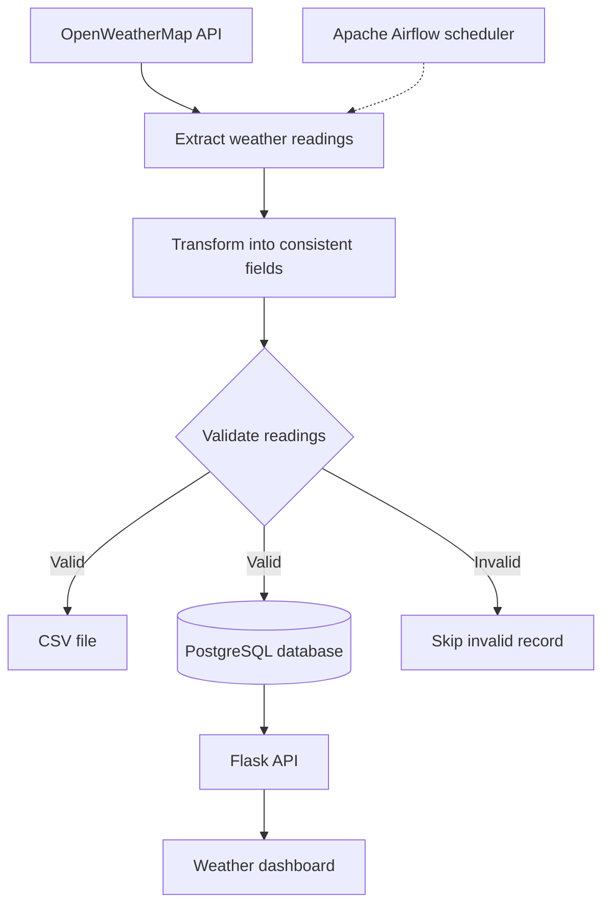

🌦️ SA Weather Observatory
From weather data to a dashboard anyone can understand
   
A South African weather data engineering project with a beginner-friendly dashboard.

🚀 Quick start · 🧭 Choose your journey · 🧩 How it works · 🧪 Tests · 🆘 Help

[!NOTE]
This dashboard shows recorded historical observations, not a live forecast. It works on the computer running Docker (localhost).

🚀 Quick start — three commands
First, open a terminal inside the folder containing docker-compose.yml. You need Docker installed and a configured .env file (see the setup guide below).
docker compose config --services
docker compose up -d --build postgres dashboard
curl http://localhost:5050/api/health
Then open 🌐 Weather dashboard — http://localhost:5050 on that computer.
[!TIP]
A new database can be empty. To collect readings, configure an OpenWeatherMap API key and run docker compose run --rm app.

🧭 Choose your journey
I want to…	Start here
👀 Just see the weather dashboard	Start dashboard
🌦️ Collect new weather readings	Run ETL
⏰ Schedule automatic collection	Airflow guide
🧪 Run the automated tests	Testing guide
🔧 Fix an error	Troubleshooting

🧩 How it works

<strong>📖 What do ETL, API, database, and Docker mean?</strong>
- ETL: Extract (get data), Transform (organize it), Load (save it). This project also validates data before saving.
- API: A way for programs to ask each other for information.
- PostgreSQL: A database that stores weather records.
- Docker: A way to run the different services together without installing every component manually.
- Airflow: A scheduler that can run the ETL workflow automatically.

📚 Interactive step-by-step guide
Click any heading below to expand the instructions. Start with setup if this is your first time.

<strong>1. What did I build?</strong>

Imagine checking the weather in several South African cities every few hours, writing the results in a notebook, and drawing graphs to compare them. This project does that automatically.

It retrieves weather readings from OpenWeatherMap, cleans and checks them, saves them to PostgreSQL (a database) and CSV (a spreadsheet-friendly file), and displays the stored readings on a website. Apache Airflow can schedule the collection every six hours.

In plain English: It is a system for collecting, storing, checking, and exploring South African weather history—not a weather forecasting service.
What the dashboard shows
- Total recorded weather observations and monitored cities.
- Average temperature and humidity across stored observations.
- Temperature history and latest readings for cities.
- City filtering and historical weather records.
Important: The dashboard displays stored historical readings. It is not necessarily showing the current weather. A new reading appears only after the pipeline runs and successfully saves it. The chart uses Chart.js from the internet, so the chart may require an internet connection.

<strong>2. What software is used, and why?</strong>
Technology	Simple explanation
Python	The programming language that collects and processes data
OpenWeatherMap API	The service that supplies weather readings; requires an API key
PostgreSQL	A digital filing cabinet that stores weather records
CSV	A file that opens in spreadsheet programs
Flask	Connects the database to the dashboard through an API
HTML, CSS, JavaScript, Chart.js	Creates the web page and charts
Apache Airflow	An automatic scheduler that runs the pipeline every six hours
Docker Compose	Starts the different parts of the project together
pytest	Checks that the Python code behaves as expected

The weather collection configuration originally includes nine South African cities, one per province. The database can contain more city names over time; the dashboard lists the distinct locations actually stored.

<strong>3. What you need before starting</strong>

This guide uses Ubuntu / Pop!_OS Linux commands. You will need:
1. A computer with an internet connection.
2. Docker Engine and the Docker Compose plugin, installed and running. Installation instructions: https://docs.docker.com/engine/install/ubuntu/ and https://docs.docker.com/compose/install/linux/ . Pop!_OS users should check Docker's Linux compatibility guidance.
3. A copy of this project folder, extracted from its ZIP file or cloned from its repository.
4. A free OpenWeatherMap API key if you want to collect new weather readings: https://openweathermap.org/api . A new key may need time to activate.
5. Python 3 and pip if you want to run the automated tests locally.
Open a terminal using Ctrl + Alt + T. A terminal is the window where you type the commands below. Run each command and press Enter.

Check Docker:
docker --version
docker compose version
docker info
If docker info reports that it cannot connect to the Docker daemon, try:
sudo systemctl start docker
If Docker reports a permission error, use the official Docker post-install instructions to configure access. Do not change permissions on the Docker socket to 777.

<strong>4. Open the right project folder (very important)</strong>

Your project must contain docker-compose.yml, dashboard_api/, weather_etl/, and tests/ in the same folder.

For the folder layout used during development, run:
cd ~/Documents/sa-weather-etl-pipeline/sa-weather-etl-pipeline
pwd
ls
If someone else downloaded the project elsewhere, replace the cd path with their project location. pwd shows where you are; ls shows files. If you see no such service: dashboard, you are probably in the wrong folder or using an older docker-compose.yml.

Verify the services:
docker compose config --services
The updated project includes postgres, dashboard, app, airflow-postgres, airflow-init, airflow-webserver, and airflow-scheduler (the order may differ).

<strong>5. Set up private configuration (`.env`)</strong>

The project needs a file named .env next to docker-compose.yml. It holds configuration and secrets. Do not upload this file to GitHub or share its contents.

If you already have a working .env, keep it; do not overwrite it. Otherwise create one:
nano .env
Paste the following example and replace the password and API key with your own values:
DB_HOST=localhost
DB_PORT=5432
DB_NAME=weather_db
DB_USER=weather_user
DB_PASSWORD=replace_with_your_private_password
API_KEY=replace_with_your_openweathermap_api_key
AIRFLOW_UID=50000
On Linux, AIRFLOW_UID can be set to the number printed by id -u. To save in nano: Ctrl + O, Enter, then Ctrl + X.

Explanation: DB_NAME is the database name, DB_USER is its account, DB_PASSWORD is its password, and API_KEY permits weather requests. DB_PORT is the computer's PostgreSQL port. Docker automatically uses the internal database host postgres for the application containers, even though .env uses localhost for local tools.

Check configuration without displaying your secrets:
docker compose config --services
If Docker warns that variables are not set, check that .env is in the correct folder. Do not paste docker compose config output publicly because it can contain secrets.

Note: If PostgreSQL was already initialized with a different username or password, editing .env alone does not update the existing database account. Keep the working credentials or explicitly migrate the database credentials; do not delete volumes to solve a password mismatch.

<strong>6. Start the weather dashboard (easiest first run)</strong>

From the project folder:
docker compose up -d --build postgres dashboard
This downloads/builds what is needed and starts the weather database and dashboard. The first run can take a few minutes. -d keeps them running in the background; --build creates the latest application image.

Check status:
docker compose ps
You want the postgres service to be healthy and the dashboard service to be running.

Open your web browser and enter:

http://localhost:5050

localhost means this computer. This link works on the computer running Docker; it is not a public website.

Check that the API can reach the database:
curl http://localhost:5050/api/health
A healthy response looks like:
{"database":"connected","status":"ok"}
If the dashboard has no readings yet, that is normal for a new database. Continue to the next step to collect data.

<strong>7. Collect weather readings now (run ETL manually)</strong>

Make sure your OpenWeatherMap key in .env is valid. Then run:
docker compose run --rm app
This starts the ETL job once, collecting and processing weather readings, then exits. The --rm option removes its temporary container after completion.

To see whether it worked, examine the terminal output. You can also run:
docker compose logs --tail=100 app
Note: docker compose run --rm app creates a temporary container; its logs may not appear under the long-lived app service afterward. The terminal output from the run is the most reliable place to check that particular execution.

Refresh http://localhost:5050 in your browser. The dashboard reads the PostgreSQL records. The CSV file is written to output/weather_data.csv in the project folder.

Each successful run adds observations. It does not replace earlier observations. If the API fails or no readings pass validation, no new records may be added.

<strong>8. Check the saved data (no SQL knowledge required)</strong>

To count stored weather records, copy and paste:
docker compose exec postgres sh -c 'psql -U "$POSTGRES_USER" -d "$POSTGRES_DB" -c "SELECT COUNT(*) FROM weather_data;"'
To see the nine most recently saved records:
docker compose exec postgres sh -c 'psql -U "$POSTGRES_USER" -d "$POSTGRES_DB" -c "SELECT city, temperature_c, humidity_percent, extracted_at FROM weather_data ORDER BY extracted_at DESC LIMIT 9;"'
What is SQL? It is a language for asking questions of a database. SELECT reads records; these commands do not delete or change anything.

If you get role "root" does not exist, it usually means you used an empty $DB_USER in the host terminal. Use the commands above exactly: they read the correct database username inside the container.

If you get relation "weather_data" does not exist, run the ETL job once (Step 7) to create the table, then retry.

<strong>9. Run the pipeline automatically with Airflow (optional)</strong>

Airflow is like an alarm clock for the ETL job. The project DAG is called sa_weather_etl_pipeline and is scheduled every six hours (00:00, 06:00, 12:00, 18:00 in Airflow's timezone, normally UTC).

Start the Airflow services:
docker compose up -d --build airflow-init airflow-webserver airflow-scheduler
The initial build may take several minutes. Then visit:

http://localhost:8080

The development configuration creates the account:
Username: admin
Password: admin
These credentials are for local demonstration only. Change them before making Airflow accessible to other people or a network.

In Airflow, find sa_weather_etl_pipeline, enable/unpause it, and click Trigger DAG to run it immediately. A DAG is simply Airflow's name for a scheduled workflow.

Alternatively, use the terminal:
docker compose exec airflow-scheduler airflow dags unpause sa_weather_etl_pipeline
docker compose exec airflow-scheduler airflow dags trigger sa_weather_etl_pipeline
Check the scheduler logs:
docker compose logs --tail=100 airflow-scheduler
Airflow has its own separate PostgreSQL database for scheduling information. The weather readings remain in the postgres database.

<strong>10. Explore the Flask API (optional)</strong>

An API is a way for one program to request information from another. The Flask API reads stored data; it does not write to the database.

Try these addresses in a browser, or use curl:
curl http://localhost:5050/api/health
curl http://localhost:5050/api/cities
curl http://localhost:5050/api/summary
curl http://localhost:5050/api/latest
curl 'http://localhost:5050/api/history?city=Johannesburg&limit=10'
/api/cities lists available cities; /api/summary reports totals and averages; /api/latest returns the latest readings; /api/history returns saved historical observations. The history endpoint supports a limit of up to 1,000 records.

<strong>11. Run automated tests (for developers and assessors)</strong>

Automated tests are short programs that check whether the project behaves correctly. They do not need your real API key or a live PostgreSQL database because the tests use mocks (simulated responses and database connections).

Check Python:
python3 --version
If Python's virtual environment package is missing on Ubuntu/Pop!_OS:
sudo apt update
sudo apt install python3-venv python3-pip
Create a private Python environment, activate it, and install testing dependencies:
python3 -m venv .venv
source .venv/bin/activate
python3 -m pip install -r requirements.txt
python3 -m pip install -r dashboard_api/requirements.txt
python3 -m pip install pytest pytest-cov
Run every test:
python3 -m pytest tests/ -v
Generate a code coverage report:
python3 -m pytest tests/ -v \
  --cov=weather_etl \
  --cov=dashboard_api \
  --cov-report=term-missing \
  --cov-report=html
Open the visual report:
xdg-open htmlcov/index.html
Verified project result on 9 November 2026: 44 tests passed, 0 failed, 83% statement coverage. These are the results from the tested project at that point in time; your results may differ after code changes. 83% coverage does not mean 83% of all possible errors are prevented.

To leave the Python virtual environment:
deactivate

<strong>12. Everyday commands — quick reference</strong>

All commands below should be run from the folder containing docker-compose.yml.
What you want to do	Command
Start database and dashboard	docker compose up -d postgres dashboard
Open dashboard	http://localhost:5050
Collect new readings once	docker compose run --rm app
See running containers	docker compose ps
View dashboard errors	docker compose logs --tail=100 dashboard
View database errors	docker compose logs --tail=100 postgres
Follow live logs	docker compose logs -f dashboard (press Ctrl+C to stop watching)
Start Airflow	docker compose up -d airflow-init airflow-webserver airflow-scheduler
Open Airflow	http://localhost:8080
Run all tests	python3 -m pytest tests/ -v
Stop services, keep data	docker compose down
Restart dashboard after code changes	docker compose up -d --build dashboard

Stop the application safely
docker compose down
This stops and removes the containers but keeps database volumes, so stored weather history remains available next time.

Danger — do not run this unless you intentionally want to erase your database and Airflow history:
docker compose down -v
The -v option removes Docker volumes and can permanently delete stored data. It is not needed for normal use.

<strong>13. Project folders explained</strong>
sa-weather-etl-pipeline/
├── dashboard_api/              Flask backend and frontend files
│   ├── app.py                  API endpoints
│   ├── static/                 Web page assets
│   └── Dockerfile              Dashboard container instructions
├── weather_etl/                Data collection and cleaning code
│   ├── extract.py              Download weather readings
│   ├── transform.py            Reorganize weather data
│   ├── validate.py             Check data quality
│   ├── load.py                 Save to CSV and PostgreSQL
│   ├── db.py                   Database helpers
│   └── pipeline.py             Run all ETL steps
├── dags/                       Airflow scheduled workflow
├── docker/airflow/             Airflow Docker image
├── tests/                      Automated unit tests
├── output/                     Generated CSV weather readings
├── logs/                       Generated log files
├── docker-compose.yml          Defines all Docker services
├── requirements.txt            Python ETL dependencies
├── .env                        Private configuration — DO NOT COMMIT
└── README.md                   This guide

<strong>14. Troubleshooting (common beginner problems)</strong>
Problem	What it means / how to fix it
no such service: dashboard	You are in the wrong project folder or have an old Compose file. Run pwd, ls, and docker compose config --services.
DB_PASSWORD variable is not set	Your .env file is missing, incomplete, or in the wrong directory. Revisit Step 5.
role "root" does not exist	The PostgreSQL username was not passed. Use the exact docker compose exec postgres sh -c 'psql ...' examples in Step 8.
python: command not found	Use python3 instead.
tests/test_dashboard_api.py not found	Make sure you are in the correct folder and the tests are inside its tests/ directory.
localhost:5050 does not load	Run docker compose ps and docker compose logs --tail=100 dashboard; check whether port 5050 is occupied.
port is already allocated	Another program uses the port. For the dashboard, change "5050:5000" to "5051:5000" in docker-compose.yml, restart, and open http://localhost:5051.
Dashboard opens but shows zero records	Run docker compose run --rm app, check API key and logs, then refresh the page.
Weather API responds with 401	The API key is missing, incorrect, or not activated yet.
relation "weather_data" does not exist	The weather table has not been created. Run the ETL pipeline once.
Chart is blank but cards appear	Check your internet connection; Chart.js is loaded from an external CDN.
Airflow doesn't run automatically	Start its scheduler and webserver, then make sure the DAG is unpaused.
Tests fail due to missing Python packages	Activate .venv and reinstall the requirements from Step 11.

For more detailed diagnosis, run:
docker compose ps -a
docker compose logs --tail=100 postgres dashboard
Do not post your .env file, passwords, API key, or unredacted configuration output when asking for help.

<strong>15. Known limitations and future improvements</strong>
- The dashboard displays recorded observations, not forecasts or guaranteed real-time conditions.
- Weather readings depend on a valid API key and a successful pipeline run.
- The dashboard does not currently show the true Airflow run state; it shows data retrieved from PostgreSQL.
- The CSV and PostgreSQL stores are populated by the pipeline; the dashboard does not automatically import a CSV into PostgreSQL.
- Airflow's demo login is not secure for a publicly exposed server.
- The current test suite focuses on Python unit tests. End-to-end browser testing and production deployment are possible future improvements.

<strong>16. A simple presentation script</strong>
“I built a South African weather data engineering system. It collects weather information from an external service, organizes it, checks for incorrect readings, and saves the results in a database and CSV file. Apache Airflow can repeat this process automatically every six hours. I also built a web dashboard so people can understand the information without writing code. Finally, I tested the system with 44 automated tests, which all passed, and measured 83% code coverage.”

Project type: Data Engineering elective · Dashboard: Flask + JavaScript · Database: PostgreSQL · Automation: Apache Airflow · Deployment: Docker Compose

💬 Beginner questions

<strong>Do I need to know how to code?</strong>
No. To view the dashboard, follow the Docker setup and open the local address. The tests and API sections are optional.

<strong>Will I see today's weather?</strong>

Not necessarily. The charts show observations already stored by the ETL pipeline. Run the pipeline again to add new readings.

<strong>Can I share the localhost link with a friend?</strong>

No. localhost refers to the computer running Docker. Public hosting would require separate deployment and security configuration.

<strong>What if I make a mistake?</strong>

Use the troubleshooting section above. docker compose down stops services without deleting stored database volumes. Avoid docker compose down -v unless you intentionally want to delete stored data.

Built as a Data Engineering elective project — Python · PostgreSQL · Airflow · Flask · Docker

